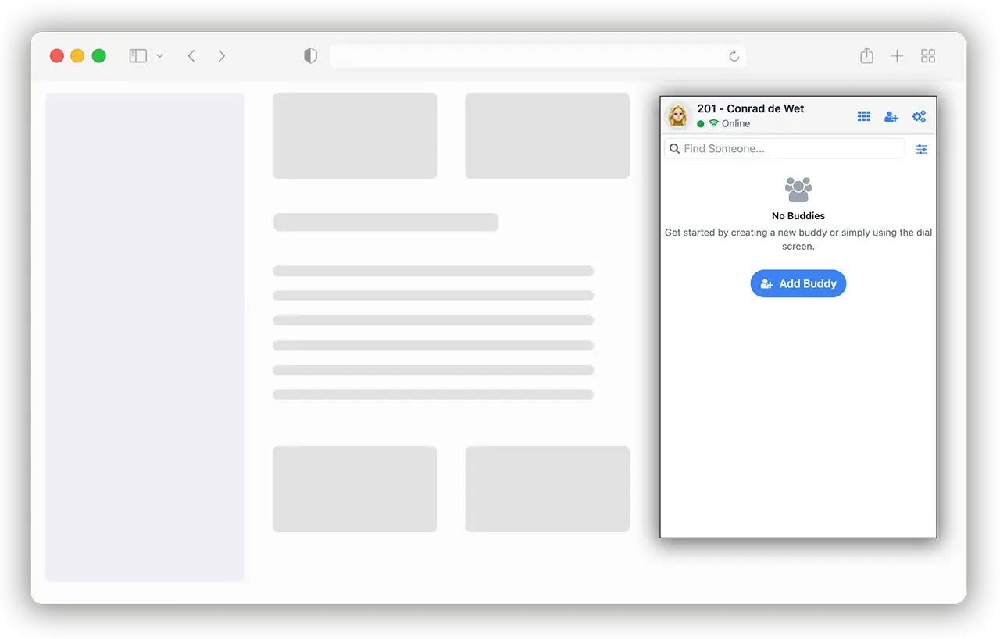

# Web Phone

Open‑source Browser Phone / Web Phone SDK for WebRTC and VoIP. Build your own phone UI on the
Siperb Browser Phone SDK, embed a finished phone in an iframe, or provision SIP.js, JsSIP and your
own client from a Siperb account.

[](https://github.com/Siperb/Web-Phone)
[](https://github.com/Siperb/Web-Phone/blob/main/LICENSE)


[](#two-ways-to-start)

[](https://www.siperb.com/)



## Two ways to start

### 1. The headless SDK: your own UI

One script gives you a working SIP phone in the page: registration, calls, hold, mute, DTMF and the
far end's audio. You draw the UI.

```html
<script src="https://cdn.siperb.com/lib/Browser-Phone-SDK/browser-phone-sdk-1.0.208.min.js"></script>
<script>
    phone.On("SipProviderStatus", (status) => console.log("SIP:", status));
    phone.On("OnIncomingCall", (call) => phone.Answer(call.SessionId));

    phone.Init({
        ProfileUserId: "alice",
        wssServer: "sip.example.com",
        SipUsername: "alice",
        SipPassword: "secret",
        SipDomain: "example.com",
        Settings: { MediaLocation: "https://cdn.siperb.com/media/" },
    }).then(() => phone.Dial("+15551234567"));
</script>
```

Read the [headless SDK guide](./docs/getting-started/headless.md), or run `test-Headless.html`.

### 2. The embedded Browser Phone: a finished phone

The complete Siperb phone UI, loaded from the CDN into an iframe you own and provisioned from your
Siperb account.

```html
<iframe id="thePhone" src="about:blank" style="width:400px;height:640px;border:0"></iframe>
<script src="https://cdn.siperb.com/lib/Siperb-Web-Phone/Web-Phone-<VERSION>.umd.min.js"></script>
<script>
    (async () => {
        const session = await Siperb.Login(PERSONAL_ACCESS_TOKEN);
        const provisioning = await Siperb.GetProvisioning({
            UserId: session.UserId, DeviceToken: DEVICE_TOKEN, SessionToken: session.SessionToken,
        });
        const frame = document.getElementById("thePhone");
        await Siperb.LoadBrowserPhone(frame);
        await Siperb.ProvisionPhone({
            Provisioning: provisioning, PhoneFrame: frame, ProfileUserId: DEVICE_TOKEN,
            SessionId: session.SessionToken, UserId: session.UserId,
        });
    })();
</script>
```

Read [the embedded Browser Phone](./docs/getting-started/iframe-phone.md), run
`test-Browser-Phone.html`, or try the [CodePen example](https://codepen.io/siperb/pen/myrOdap).

## Already have a SIP library?

The loader gives SIP.js, JsSIP or your own client the server and credentials from a Siperb account.
See [Siperb provisioning](./docs/getting-started/siperb-provisioning.md) and
[Other SIP libraries](./docs/getting-started/sip-libraries.md), with working pages in
[`test-SIPJS.html`](./test-SIPJS.html) and [`test-JSSIP.html`](./test-JSSIP.html).

## Documentation

Everything is in [`docs/`](./docs/README.md): the getting-started guides, and a reference for
[starting the phone](./docs/reference/init.md), [calls](./docs/reference/calls.md),
[events](./docs/reference/events.md), [contacts and history](./docs/reference/contacts-and-history.md),
[messaging](./docs/reference/messaging.md), [settings](./docs/reference/settings.md),
[types](./docs/reference/types.md) and [the loader](./docs/reference/loader.md).

## Click to dial

Once the phone is running, your page can place calls with `phone.Dial(number)`, which gives your
CRM, website, ERP, SaaS or intranet [click to dial](https://www.web-phone.org/click-to-dial/).

## Running the examples locally

```sh
npm install
npm run start:headless   # test-Headless.html
npm run start:phone      # test-Browser-Phone.html
npm run start:sipjs      # test-SIPJS.html
npm run start:jssip      # test-JSSIP.html
```

The pages read `window.PERSONAL_ACCESS_TOKEN` and `window.DEVICE_TOKEN` from an `env.js` file next to
them. It is gitignored: create it yourself, and never commit it. Microphone access needs `https://`
or `localhost`.

To build the loader on its own: `npm run build` writes `dist/Siperb-Web-Phone.umd.min.js` and
`dist/Siperb-Web-Phone.esm.min.js`.
